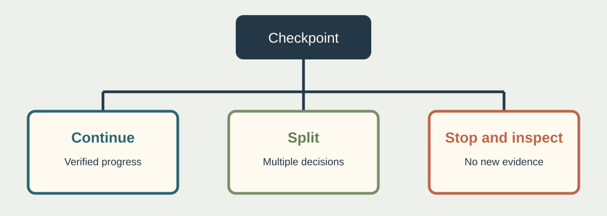

I have written about [Herdr as a place to see all the agents](https://compositecode.blog/2026/10/09/herding-agents-how-i-actually-use-herdr-on-a-ridiculously-wide-screen/) and about why I give [spaces, tabs, and panes specific jobs](https://compositecode.blog/2026/10/09/spaces-tabs-panes-and-precise-words-why-i-break-agent-work-out-the-way-i-do/). A multiplexer helps me find the agent that is blocked on a question. It does not tell me whether the agent should still be working on that question at all.

That distinction matters when several agents are active. Six sessions can all report “working” while two implement the same feature, one waits on a test process that will never exit, and another repeatedly rewrites a file to satisfy an impossible prompt. The dashboard is truthful about process state. It is silent about whether the work is useful.

## Give each run a finish line

Before starting an agent, write down its owner, scope, expected output, and stop condition. “Improve the billing service” has no finish line. “Add an idempotency check to `POST /charges`, show the duplicate request test, and stop before changing the database schema” does. The run can finish, fail, or ask for a decision. Each state has something a human can inspect.

I also set a budget appropriate to the task: elapsed time, tool calls or tokens if the platform exposes them, files touched, and number of attempted approaches. These are tripwires, not productivity scores. An agent spending twenty minutes on a slow integration test may be doing exactly the right thing. An agent spending twenty minutes alternating between two incompatible implementations is not.

A useful checkpoint is a short record of what has changed, what has been verified, what remains, and what is blocked. The evidence should be commands and artifacts, not just the agent's confidence. If a long run cannot say what changed since the previous checkpoint, I want to inspect it before buying another hour of execution.

## Long running can be legitimate

Some work has a real long pole. A full build, a large data migration rehearsal, a cross platform test matrix, or a carefully scoped investigation may need hours. The clue is visible progress against a fixed plan. The agent reaches milestones, the diff stays within scope, test results accumulate, and the remaining work gets smaller. The clock alone is a poor judge.

Other runs are long because the task contains too many different verbs. The agent is asked to research a domain, design an API, implement it, update dependencies, test it, deploy it, and review its own work. Each phase changes what “done” means. The conversation grows, old assumptions remain in context, and the agent starts using its own earlier guesses as facts. That is where I stop and split the work.

My practical test is to ask whether the current run can be reviewed without replaying the entire transcript. If the answer is no, ask for a checkpoint and create a new task with the verified facts. Split at a decision boundary: investigation into a brief, brief into a design, design into one implementation slice, implementation into an independent review. Do not split a single atomic edit into five agents just because parallelism is available. The handoff can cost more than the edit.

## Supervise the queue, not every keystroke

With several agents, I want one visible register of active work. A simple table is enough: task, owner, branch or environment, paths or interfaces owned, state, last checkpoint, and next decision. The multiplexer tells me where the process is. The register tells me what the process is allowed to change. When an agent goes blocked, I answer the decision once and record it where the next session will find it.

I keep a limit on simultaneous writers. More agents do not automatically mean more completed work. They create more integration edges and more reviewer load. Read only investigators and reviewers can often run alongside an implementer. Two agents changing the same contract, deployment configuration, or migration sequence need sequencing even if their files are separate. [Worktrees isolate files](https://compositecode.blog/2026/08/19/worktrees/); they do not isolate architecture, a shared database, or the main branch after merge.

The review agent gets a different job from the writer. It reads a committed diff and reports behavior risks with file and line evidence. It does not silently fix what it finds. A fix becomes another scoped implementation task. That keeps the person supervising the queue from confusing an agent's reported success with independent verification.

## A run needs an end, even when the project does not

“Keep going until everything is perfect” is an expensive prompt and an impossible stop condition. I prefer a bounded assignment that can end with a useful handoff: what landed, what failed, what remains, and the exact next slice. A fresh session can consume that handoff plus the source files. It does not need the entire history of abandoned attempts.

There are exceptions. An agent supervising a known batch job may stay alive to watch it, provided it has a timeout, a clear alert condition, and no open ended permission to change the system when something looks strange. A long lived process should be easier to audit than a short one, because it has more opportunities to drift.

## A punch list for a busy team

1. Name one owner and one finish line for every agent run.
2. Record the paths, interfaces, and environments each writer may touch.
3. Limit concurrent writers to the number the team can integrate and review.
4. Set checkpoints and tripwires for time, tool use, diff size, and repeated failed approaches.
5. Split work at design, implementation, and review decisions. Preserve verified facts in a short handoff.
6. Give production resources separate permissions from development resources.
7. Run meaningful behavior and failure tests before merging, then review the combined result.
8. Ship with observability and a recovery path, especially for data and deployment changes.

The aim is not to keep every agent busy. It is to keep the codebase coherent and the application boring to operate. A blocked agent is easy to spot with the right tool. A busy agent making the wrong change needs a clear assignment, evidence, and someone willing to stop the run.
