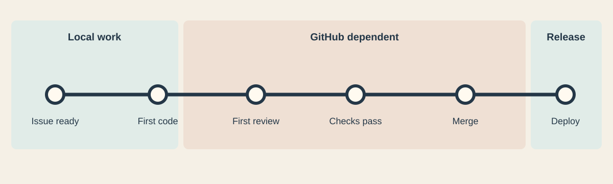

The issue is ready, the code is ready, and then the PR page spins. A check stays queued. A webhook arrives late. The review that should have taken ten minutes turns into an afternoon of refreshing GitHub and wondering which part of the pipeline is actually broken.

That is not hypothetical in October 2026. GitHub's [August 17 incident report](https://github.blog/news-insights/company-news/the-august-17-outage-and-the-work-ahead/) says a 7 hour, 47 minute outage disrupted the site, APIs, Actions, pull requests, and issues. Its [September availability report](https://github.blog/news-insights/company-news/github-availability-report-september-2026/) describes database pressure and work to contain failures in pull requests. The [status history](https://www.githubstatus.com/history) also records October delays across PRs, Issues, Actions, and webhooks. GitHub is doing capacity work. A development team still needs a plan for the hours when its work is waiting on that capacity.

## Find the actual wait

“GitHub is slow” describes the feeling, not the bottleneck. Track issue ready to first code change, code complete to first review, review complete to checks, checks complete to merge, and merge to deploy. Look at the median and the ugly tail. A slow PR page is one problem. A two day review queue is another. A CI job that queues for an hour and runs for three minutes has a different remedy from a test suite that takes an hour on a ready runner.

This measurement matters because some delays are in our own process. If a task cannot start until somebody writes an elaborate issue, or a trivial change waits behind a weekly approval meeting, GitHub uptime will not fix it. Write the acceptance criteria and the risk in a short issue or local task note, then let implementation start. The artifact should help the next person understand the work, not become a ceremony the work must survive.

## Move the fast feedback close to the code

Make the build, focused tests, formatting, and relevant static checks runnable with one documented local command. Run them before opening the PR. A remote check is still useful as the shared attestation, but it should confirm a result developers can reproduce, not be the first place anyone discovers a compiler error. Cache dependencies carefully, keep the quick checks quick, and reserve expensive matrices for changes that need them.

Review can begin from a branch or a patch while the PR UI is unhealthy. A reviewer can read `git diff`, run the relevant tests, and write findings in a shared local note. When GitHub recovers, put that discussion on the PR so the decision remains visible with the change. Do not mistake a green local run for the required check on a protected branch. [Branch protection](https://docs.github.com/en/repositories/configuring-branches-and-merges-in-your-repository/managing-protected-branches/about-protected-branches) is a team contract, and an outage is a poor reason to silently discard it.

## Keep a second path for coordination

Issues are a convenient source of truth until the issue service is unavailable. Keep enough task context in the repository or another team owned system to continue: a task ID, expected behavior, owner, and decision log. It can be a small Markdown file. When GitHub returns, reconcile it to the canonical issue. Avoid two competing permanent backlogs.

Git itself is distributed. If GitHub's web services are degraded but Git operations still work, teams can continue committing and exchanging branches through the remote. If Git operations are unavailable too, local commits keep the work safe. For a prepared contingency between trusted machines, [Git bundles](https://git-scm.com/docs/git-bundle) can carry repository history without a live server. A second forge or internal mirror can provide a more complete continuity path, but only if the team has already rehearsed access, review, and reconciliation. Setting one up during an incident is not a shortcut.

Self hosted Actions runners solve a different problem: where jobs execute. [They still connect to GitHub for job assignments](https://docs.github.com/en/actions/reference/runners/self-hosted-runners), so they do not remove the Actions control plane dependency. A locally runnable test script does. A separate CI system can, if its triggers and repository access are independent too.

## Reduce the amount of GitHub work per change

A giant PR asks the platform and the reviewer to do too much at once. Keep changes small enough to inspect and merge. Separate mechanical cleanup from behavior changes. Use feature flags or compatible incremental changes so one PR need not contain the entire release. Avoid automations that trigger redundant workflows on every push, comment, label, and issue edit. They add queue pressure and make it harder to tell which signal matters.

This is also where agent output can hurt. An agent that opens a PR for every tiny correction can swamp reviewers and checks. One that generates a thousand file change is worse. The useful middle is a coherent slice with a clear behavior change and a reproducible local result.

## Decide what happens during an outage before one happens

For ordinary work, keep committing, testing, and reviewing locally, then publish when service recovers. For urgent production work, use the team's documented emergency path, including independent review, recorded test evidence, and a later audit trail. If branch rules require a specific bypass, make that an explicit incident decision by the people authorized to make it. Do not give agents broad bypass permission so they can “keep shipping.”

GitHub should remain a useful place to coordinate and verify work. It does not need to be the only place work can happen. The practical goal is a pipeline that can keep making safe progress when a PR page, webhook, or runner queue has a bad day.
